# Tutorial: Membuat Karakter Anime 2.5D yang Bergerak (Studi Kasus: Chisato Nishikigi)

Tutorial ini menjelaskan **lengkap, langkah demi langkah**, bagaimana karakter Chisato Nishikigi
(Lycoris Recoil) dibuat jadi avatar 2.5D yang bisa berkedip, menoleh dengan efek parallax, melirik
mengikuti kursor, dan rambut + pitanya bergoyang — meniru
[demo libwaifu/waifu2d](https://x.com/ling0322/status/2116457843981455648).

Isinya bukan cuma "perintahnya apa", tapi juga **kenapa** tiap keputusan diambil dan **masalah apa
saja yang muncul** di tengah jalan beserta solusinya.

---

## Daftar Isi

1. [Gambaran Besar](#1-gambaran-besar)
2. [Riset: Bagaimana Demo Itu Dibuat?](#2-riset-bagaimana-demo-itu-dibuat)
3. [Persiapan Lingkungan (VPS GPU)](#3-persiapan-lingkungan-vps-gpu)
4. [Langkah 1 — Membuat Gambar Sumber dengan SDXL](#4-langkah-1--membuat-gambar-sumber-dengan-sdxl)
5. [Langkah 2 — Upscale (Hires Fix) ke 1280px](#5-langkah-2--upscale-hires-fix-ke-1280px)
6. [Langkah 3 — Dekomposisi Layer dengan See-through](#6-langkah-3--dekomposisi-layer-dengan-see-through)
7. [Langkah 4 — Merapikan PSD untuk Rigging](#7-langkah-4--merapikan-psd-untuk-rigging)
8. [Langkah 5 — Rigging & Animasi dengan Anime2.5DRig](#8-langkah-5--rigging--animasi-dengan-anime25drig)
9. [Langkah 6 — Merekam Video 60fps dengan Jam Virtual](#9-langkah-6--merekam-video-60fps-dengan-jam-virtual)
10. [Langkah 7 — Komposit Background & Encode MP4](#10-langkah-7--komposit-background--encode-mp4)
11. [Evaluasi & Memilih Hasil Terbaik](#11-evaluasi--memilih-hasil-terbaik)
12. [Troubleshooting: Semua Masalah yang Ditemui](#12-troubleshooting-semua-masalah-yang-ditemui)
13. [Ringkasan Perintah (Cheat Sheet)](#13-ringkasan-perintah-cheat-sheet)
14. [Mengganti Karakter Lain](#14-mengganti-karakter-lain)
15. [Struktur File Project](#15-struktur-file-project)
16. [Lisensi & Kredit](#16-lisensi--kredit)

---

## 1. Gambaran Besar

```mermaid
flowchart LR
    A[Prompt teks] -->|WAI-Illustrious SDXL| B[Gambar 1024px]
    B -->|img2img hires fix| C[Gambar 1280px]
    C -->|See-through<br/>LayerDiff 3D + Marigold| D[PSD ~20 layer<br/>ter-inpaint & urut depth]
    D -->|build_psd.py| E[PSD siap rig]
    E -->|Anime2.5DRig<br/>WebGL di browser| F[Avatar 2.5D bergerak]
    F -->|record.js<br/>Chrome headless + jam virtual| G[720 frame PNG transparan]
    G -->|compose.py + ffmpeg| H[MP4 1080x1080 60fps]
```



| Tahap | Alat | Jalan di | Waktu (RTX A4000) |
|---|---|---|---|
| Generate gambar | diffusers + WAI-Illustrious SDXL v17 | VPS (GPU) | ~16 detik/gambar |
| Hires fix 1280px | diffusers img2img | VPS (GPU) | ~30 detik |
| Pisah layer | See-through (`inference_psd.py`) | VPS (GPU) | ~14 menit/gambar (mode `--group_offload`) |
| Rapikan PSD | `build_psd.py` (psd-tools) | VPS (CPU) | beberapa detik |
| Rig + animasi | Anime2.5DRig (JS/WebGL) | Browser | real-time |
| Rekam frame | `record.js` (puppeteer + Chrome headless) | VPS (CPU) | ~1m45s untuk 720 frame |
| Komposit + encode | `compose.py` + ffmpeg | VPS (CPU) | ~2 menit |

**Prinsip kerja:** kode ditulis/diedit di laptop lokal, semua komputasi berat (SDXL, See-through,
render) dijalankan di VPS GPU (`labkm-vps`), hasilnya di-`rsync` balik ke lokal.

---

## 2. Riset: Bagaimana Demo Itu Dibuat?

Sebelum mulai, demo dipelajari dulu supaya hasilnya benar-benar "cantik kayak demonya".

### 2.1 Membaca tweet demo

Tweet di X tidak bisa dibaca tanpa login, jadi dipakai API publik **fxtwitter**:

```bash
curl -s https://api.fxtwitter.com/ling0322/status/2116457843981455648 | python3 -m json.tool
```

Isi tweet (diterjemahkan): *"libwaifu/waifu2d versi pertama selesai! … Seluruh alur otomatis:
**gambar AI → See-through memisah layer → animasi digerakkan**, tanpa edit manual."*

Dari JSON yang sama didapat URL video MP4-nya. Video diunduh dan dibuat *contact sheet* untuk
dipelajari:

```bash
curl -sL -o demo.mp4 "https://video.twimg.com/amplify_video/.../1220x720/....mp4"
ffmpeg -i demo.mp4 -vf "fps=0.6,scale=1220:-1,tile=2x3" -frames:v 1 sheet.jpg
```

**Pengamatan dari demo (Hatsune Miku):**
- Gambar **bust-up** (kepala sampai dada), **menghadap lurus ke depan**, **simetris**.
- Wajah besar di frame → detail mata tajam.
- Kanvas **1280×1280**, 22 layer.
- Gerakan: *Follow the pointer*, *Sway*, *Look around*, *Hair swings*, *Blink*.

### 2.2 Menelusuri kode libwaifu

```bash
git clone --depth 1 https://github.com/ling0322/libwaifu.git
grep -ril "waifu2d\|rig" libwaifu --include=*.swift
```

Temuan penting: animasi waifu2d ada di `waifu-app/swiftui/Sources/Waifu/Rig*.swift` — **aplikasi
macOS (Swift + Metal)**, tidak bisa jalan di Linux. Tapi komentar di `Rig.swift` menyebutkan:

> rigged … the way **Anime2.5DRig** (https://github.com/852wa/Anime2.5DRig, MIT) rigs one …
> Its numbers are Anime2.5DRig's (lib/rigger.js)

Artinya rig di demo itu adalah **port dari Anime2.5DRig**, sebuah tool **berbasis browser (WebGL)**
yang open-source. Jadi kita bisa mendapat kualitas gerakan yang sama di Linux dengan memakai
Anime2.5DRig langsung.

### 2.3 Kesimpulan riset

Kualitas "cantik" di demo ditentukan oleh 3 hal:
1. **Gambar input** yang tepat (bust-up, frontal, resolusi tinggi, latar polos).
2. **See-through** untuk memisah layer dengan inpainting (bagian yang tertutup ikut digambar).
3. **Rig Anime2.5DRig** (kedip, parallax, fisika rambut 2 pegas).

Percobaan sebelumnya gagal cantik karena gambar inputnya **full-body & kecil (768px)** dan
animasinya cuma parallax sederhana buatan sendiri.

---

## 3. Persiapan Lingkungan (VPS GPU)

### 3.1 Spesifikasi VPS yang dipakai

- Alias SSH: `labkm-vps` (diatur di `~/.ssh/config`)
- 32 core, 32 GB RAM, **NVIDIA RTX A4000 16 GB** (LXC, ~11,6 GB VRAM yang benar-benar bisa dipakai)
- Python 3.12 (venv), Node 24 di `/opt/node24/bin`, ffmpeg

Cek cepat:

```bash
ssh labkm-vps 'nvidia-smi --query-gpu=name,memory.used,memory.total --format=csv; df -h /'
```

> **Disk:** model See-through ±12,6 GB + WAI-Illustrious 6,9 GB + torch dll. Siapkan minimal ~30 GB kosong.

### 3.2 Install See-through (sekali saja)

```bash
ssh labkm-vps
cd /root
git clone https://github.com/shitagaki-lab/see-through.git
cd see-through

# venv Python 3.12
python3.12 -m venv .venv
source .venv/bin/activate

# PyTorch CUDA 12.8
pip install torch==2.8.0+cu128 torchvision==0.23.0+cu128 torchaudio==2.8.0+cu128 \
  --index-url https://download.pytorch.org/whl/cu128

pip install -r requirements.txt
ln -sf common/assets assets      # wajib, script mengharapkan ./assets
```

Model See-through (`layerdifforg/seethroughv0.0.2_layerdiff3d` ±9,5 GB dan
`24yearsold/seethroughv0.0.1_marigold` ±3,1 GB) **otomatis terunduh** ke
`~/.cache/huggingface/hub` saat pertama kali dijalankan.

Venv yang sama (`/root/see-through/.venv`) juga dipakai untuk generate gambar SDXL, karena sudah
berisi `diffusers`, `torch`, `transformers`, `psd_tools`, `Pillow`, `numpy`.

### 3.3 Folder kerja

Semua pekerjaan baru ditaruh di folder terpisah agar repo See-through tetap bersih:

```bash
mkdir -p /root/chisato25d/{models,scripts}
```

### 3.4 Puppeteer + Chrome untuk merekam

```bash
cd /root/chisato25d
export PATH=/opt/node24/bin:$PATH
npm init -y && npm i puppeteer-core@23
```

Chrome tidak perlu diinstal terpisah — dipakai **Chrome for Testing** yang sudah ada di VPS (bawaan
project Remotion/HyperFrames lain):

```
/root/render-goodenough-battery-20261031-100553/node_modules/.remotion/chrome-for-testing/linux64/chrome-linux64/chrome
```

Kalau tidak ada, bisa pakai `npx @puppeteer/browsers install chrome@stable`.

### 3.5 Pola sinkronisasi lokal ↔ VPS

```bash
# kirim script dari lokal ke VPS
rsync -a scripts/ labkm-vps:/root/chisato25d/scripts/
# ambil hasil dari VPS ke lokal
rsync -a labkm-vps:/root/chisato25d/out/ out/
```

---

## 4. Langkah 1 — Membuat Gambar Sumber dengan SDXL

### 4.1 Memilih model

Dipakai **WAI-Illustrious SDXL v17** — turunan Illustrious XL yang dilatih dengan tag Danbooru, jadi
**sudah kenal karakter `nishikigi chisato`** tanpa LoRA. (Demo libwaifu juga menyediakan model ini
sebagai `sdxl:wai`.)

Cari repo di Hugging Face lewat API:

```bash
curl -s "https://huggingface.co/api/models?search=waiIllustrious&sort=downloads&limit=8"
curl -s "https://huggingface.co/api/models/LyliaEngine/waiIllustriousSDXL_v170/tree/main"
```

Unduh (single-file `.safetensors`, 6,9 GB) di VPS:

```bash
cd /root/chisato25d/models
/root/see-through/.venv/bin/python -c "
from huggingface_hub import hf_hub_download
hf_hub_download('LyliaEngine/waiIllustriousSDXL_v170', 'waiIllustriousSDXL_v170.safetensors',
                local_dir='/root/chisato25d/models')"
```

### 4.2 Script `scripts/gen_chisato.py`

Inti script:

```python
pipe = StableDiffusionXLPipeline.from_single_file(ckpt, torch_dtype=torch.float16)
pipe.scheduler = EulerAncestralDiscreteScheduler.from_config(pipe.scheduler.config)
pipe.to("cuda")
img = pipe(prompt=PROMPT, negative_prompt=NEGATIVE, width=1024, height=1024,
           num_inference_steps=28, guidance_scale=6.0,
           generator=torch.Generator("cuda").manual_seed(seed)).images[0]
```

Setting: **Euler Ancestral, 28 step, CFG 6, 1024×1024** (setting standar yang direkomendasikan untuk
model Illustrious).

### 4.3 Menyusun prompt (bagian paling menentukan!)

Tujuannya gambar yang **mudah di-rig**:

| Kebutuhan rig | Tag yang dipakai |
|---|---|
| Karakter benar | `nishikigi chisato, lycoris recoil, lycoris uniform, red dress, blue neck ribbon, red eyes` |
| Bust-up | `upper body` |
| Frontal & simetris (parallax kiri/kanan seimbang) | `looking at viewer, straight-on, symmetrical` |
| Mata terbuka (rig butuh mata terbuka untuk kedip) | positif: `smile, red eyes`; negatif: `closed eyes, ^_^` |
| Tangan tidak mengganggu wajah/badan | positif: `arms at sides`; negatif: `hands, v` |
| Latar polos (See-through lebih bersih) | `white background, simple background`; negatif: `detailed background` |

Prompt final:

```text
PROMPT:
masterpiece, best quality, nishikigi chisato, lycoris recoil, 1girl, solo,
lycoris uniform, red dress, blue neck ribbon, upper body,
looking at viewer, straight-on, symmetrical, smile, red eyes,
white background, simple background, arms at sides

NEGATIVE:
worst quality, bad quality, lowres, closed eyes, ^_^, hands, v, from side, profile,
detailed background, nude, text, watermark, blurry, cropped head
```

### 4.4 ⚠️ Jebakan: batas 77 token CLIP

Percobaan pertama memakai prompt panjang (banyak tag kualitas + deskripsi detail). Hasilnya:
- Seragam **hilang** (Chisato pakai kaos putih / telanjang bahu)
- Latar **tidak putih**
- **Mata tertutup** di hampir semua gambar

Penyebabnya terlihat di log:

```
The following part of your input was truncated because CLIP can only handle sequences up to 77 tokens:
['red hair ribbon, one side up, red eyes, lycoris uniform, red dress, ...']
```

SDXL di diffusers **membuang semua token setelah ke-77**. Tag seragam, warna mata, dan latar ada di
bagian yang terbuang; di negative prompt, `closed eyes` juga terbuang.

**Solusi:** pangkas prompt ke tag yang benar-benar penting dan **taruh tag kritis di depan**.
Tag kosmetik (`absurdres`, `very aesthetic`, `clean lineart`, dll.) dibuang.

### 4.5 Generate banyak seed lalu pilih

```bash
cd /root/chisato25d
/root/see-through/.venv/bin/python scripts/gen_chisato.py \
  --ckpt models/waiIllustriousSDXL_v170.safetensors --out gen --seeds 1-12
```

Buat contact sheet untuk memilih (di lokal):

```python
from PIL import Image, ImageDraw
import glob
fs = sorted(glob.glob('seed_*.png')); t = 330
s = Image.new('RGB', (t*4, t*3), 'white')
for k, f in enumerate(fs):
    im = Image.open(f).convert('RGB').resize((t, t))
    ImageDraw.Draw(im).text((5, 5), f[5:9], fill='black')
    s.paste(im, ((k % 4) * t, (k // 4) * t))
s.save('sheet.jpg')
```

**Kriteria memilih:**
- Kepala **utuh** dengan sedikit ruang di atas (tidak terpotong) — seed 3 & 4 ✅
- Wajah cukup besar (detail mata) tapi bahu/dada tetap terlihat
- Benar-benar frontal, kedua mata terbuka, tidak ada tangan
- Atribut karakter lengkap (pita merah di samping, seragam merah, pita leher biru)

Terpilih **seed 3** dan **seed 4** untuk diproses lanjut.

---

## 5. Langkah 2 — Upscale (Hires Fix) ke 1280px

See-through bekerja di resolusi **1280** (default `--resolution 1280`). Daripada See-through yang
memperbesar sendiri (hasilnya buram), gambar 1024 diperbesar dulu ke 1280 lalu di-*img2img* ulang
dengan denoise rendah supaya garis tetap tajam dan detail bertambah:

```bash
for s in 3 4; do
  /root/see-through/.venv/bin/python scripts/gen_chisato.py \
    --ckpt models/waiIllustriousSDXL_v170.safetensors --out hires \
    --hires gen/seed_000$s.png --seeds $s --size 1280 --steps 30
done
```

Di dalam script:

```python
i2i = StableDiffusionXLImg2ImgPipeline(**pipe.components)   # pakai ulang bobot yang sudah dimuat
src = Image.open(path).convert("RGB").resize((1280, 1280), Image.LANCZOS)
img = i2i(prompt=PROMPT, negative_prompt=NEGATIVE, image=src, strength=0.42, ...).images[0]
```

`strength=0.42` = cukup untuk menajamkan garis tanpa mengubah komposisi/wajah.

---

## 6. Langkah 3 — Dekomposisi Layer dengan See-through

### 6.1 Apa yang dilakukan See-through

See-through (SIGGRAPH 2026) memecah **satu gambar** menjadi hingga **23 layer semantik**
(rambut depan, rambut belakang, wajah, putih mata, iris, bulu mata, alis, mulut, hidung, telinga,
leher, baju, aksesori kepala, dst.) dengan:
- **LayerDiff 3D** (SDXL) → menghasilkan layer transparan **dan meng-inpaint bagian yang tertutup**
  (mis. wajah di balik poni, rambut belakang di balik kepala). Ini yang membuat parallax tidak bolong.
- **Marigold depth** (fine-tune anime) → kedalaman tiap layer untuk urutan gambar.

### 6.2 Menjalankan

```bash
cd /root/see-through
.venv/bin/python inference/scripts/inference_psd.py \
  --srcp /root/chisato25d/seed_0004_hires1280.png \
  --save_dir /root/chisato25d/st_out \
  --save_to_psd --tblr_split --group_offload
```

| Flag | Fungsi |
|---|---|
| `--save_to_psd` | simpan hasil sebagai PSD berlayer (+ `_depth.psd`) |
| `--tblr_split` | pisahkan bagian berpasangan (mata, alis, telinga) jadi kiri/kanan |
| `--group_offload` | hemat VRAM (~10 GB puncak). Wajib di A4000 LXC yang efektif ~11,6 GB; sekitar 1,5× lebih lambat |

Karena butuh ~14 menit per gambar, dijalankan di background dengan `nohup` + file status:

```bash
cat > /root/chisato25d/run_st.sh <<'EOF'
cd /root/see-through
for s in 4 3; do
  .venv/bin/python inference/scripts/inference_psd.py \
    --srcp /root/chisato25d/seed_000${s}_hires1280.png --save_dir /root/chisato25d/st_out \
    --save_to_psd --tblr_split --group_offload > /root/chisato25d/st_$s.log 2>&1
  echo "done $s $?" >> /root/chisato25d/st_status.txt
done
EOF
nohup bash /root/chisato25d/run_st.sh > /dev/null 2>&1 &
```

Pantau dengan: `cat /root/chisato25d/st_status.txt` dan `tail -c 300 /root/chisato25d/st_4.log`.

### 6.3 Output

```
st_out/
├── seed_0004_hires1280.psd          ← PSD berlayer (urut depth)
├── seed_0004_hires1280_depth.psd    ← peta depth tiap layer
├── seed_0004_hires1280.psd.json     ← bbox, tag, depth_median tiap layer
└── seed_0004_hires1280/             ← PNG per layer + *_depth.png + reconstruction.png
```

Cek cepat isi PSD:

```bash
/root/see-through/.venv/bin/python -c "
from psd_tools import PSDImage
p = PSDImage.open('/root/chisato25d/st_out/seed_0004_hires1280.psd')
for l in p: print(repr(l.name), l.bbox)"
```

Hasil untuk Chisato (bawah → atas):

```
back hair, neck, topwear, ears-r, ears-l, face, nose, mouth,
eyewhite-r, eyewhite-l, eyebrow-l, irides-l, irides-r, eyebrow-r,
eyelash-r, eyelash-l, headwear, front hair
```

Kualitasnya bagus: wajah ter-inpaint penuh di balik poni, rambut belakang utuh, pita merah
terpisah sebagai `headwear`.

---

## 7. Langkah 4 — Merapikan PSD untuk Rigging

PSD mentah See-through **tidak langsung optimal** untuk Anime2.5DRig. Ada 4 masalah yang ditemukan
dan diperbaiki oleh `scripts/build_psd.py`:

### 7.1 Masalah 1: nama `-l` / `-r` tidak dikenali

`--tblr_split` menamai layer `eyewhite-r`, `irides-l`, dst. Di `rig/lib/rigger.js`, nama
dinormalisasi dengan:

```js
function squash(s) { return String(s).replace(/[\s_\-・･.]+/g, ''); }
```

Jadi `eyewhite-r` → `eyewhiter` → **tidak cocok dengan alias manapun** → layer jadi "tidak
terklasifikasi", mata tidak bisa berkedip/melirik. Padahal Anime2.5DRig **memisahkan kiri/kanan
sendiri** (berdasarkan centroid komponen terhubung).

**Solusi:** gabungkan pasangan `-l`/`-r` kembali menjadi satu layer bernama standar
(`eyewhite`, `irides`, `eyelash`, `eyebrow`, `ears`) di posisi urutan yang pertama.

```python
name = re.sub(r"-[lr]$", "", layer.name)
if name in index:                       # pasangan kedua → tumpuk ke yang pertama
    parts[k][1] = over(rgba, parts[k][1])
```

### 7.2 Masalah 2: pita rambut hilang

Render percobaan pertama: **pita merah yang menjuntai lenyap**, hanya simpulnya yang sedikit
terlihat. Penyebab: depth See-through menaruh `front hair` **di atas** `headwear`, dan karena
rambut depan di-inpaint (digambar ulang di bawah pita), pita tertutup total.

**Solusi:** pindahkan `headwear` ke paling atas.

```python
parts.sort(key=lambda p: p[0] == "headwear")   # sort stabil: headwear ke urutan terakhir (teratas)
```

### 7.3 Masalah 3: leher vs baju

README Anime2.5DRig menyarankan: *output See-through apa adanya membuat urutan depan-belakang leher
dan badan sulit diselesaikan; lebih aman leher digabung ke layer baju (`topwear`).*

**Solusi:** leher di-composite ke bawah `topwear` dan layer `neck` dihapus (bisa dimatikan dengan
`--keep-neck`). Pada Chisato kedua varian hampir sama, versi gabung dipakai karena lebih aman.

### 7.4 Masalah 4: "kabut" alpha & kepala terpotong

- See-through meninggalkan piksel alpha sangat kecil (≈1–5) di seluruh kanvas → dibersihkan
  (`alpha < 6 → 0`).
- Rambut Chisato menyentuh tepi atas gambar → saat kepala bergerak, rambut terpotong.
  **Solusi:** `--pad 160` memperlebar kanvas 160px ke atas dan 80px ke kiri & kanan
  (1280 → 1440×1440, tetap persegi seperti yang disarankan Anime2.5DRig).

### 7.5 Menjalankan

```bash
cd /root/chisato25d
/root/see-through/.venv/bin/python scripts/build_psd.py \
  st_out/seed_0004_hires1280.psd rig/chisato.psd --pad 160
```

Output (urutan bawah → atas):

```
back hair, topwear(+neck), ears, face, nose, mouth, eyewhite, eyebrow, irides, eyelash, front hair, headwear
```

> Fungsi `over()` di script adalah *Porter-Duff "over"* standar untuk RGBA straight-alpha, supaya
> penggabungan layer tidak menimbulkan pinggiran gelap.

---

## 8. Langkah 5 — Rigging & Animasi dengan Anime2.5DRig

### 8.1 Kenapa Anime2.5DRig

- Open-source (MIT), **semua jalan di browser** (WebGL1), tanpa server.
- Langsung menerima PSD See-through (README-nya menyebut kompatibel).
- Otomatis: deteksi anchor (mata, mulut, leher), deteksi "untaian" rambut, fisika 2 pegas
  (pangkal kaku, ujung lembut), parallax per depth, kedip dengan *closed-eye* generik bila PSD tidak
  punya layer mata tertutup, napas, sway, ikut kursor, kamera (face tracking), OBS.

### 8.2 Vendor ke project

```bash
git clone --depth 1 https://github.com/852wa/Anime2.5DRig.git
rsync -a --exclude .git --exclude __pycache__ --exclude 'sample*.psd' --exclude tests \
  --exclude start_obs.bat Anime2.5DRig/ rig/
cp chisato.psd chisato_b.psd rig/
```

(Sample PSD bawaan 18 MB dan folder tests dibuang agar ringan.)

### 8.3 Patch kecil: langsung membuka Chisato

`rig/lib/app.js`:

```js
const SAMPLE_FILES={A:'chisato.psd',B:'chisato_b.psd'};
...
}else{
  sync.startPolling();
  if(CAMERA_MODE)setAuto('cam',true);
  // chisato-2.5d: open the bundled model straight away (?model= picks another).
  {const path=RT.safeRelativePath(QUERY.get('model')||SAMPLE_FILES.A,'.psd');
   if(path)loadModel(fetchSource(path),path.split('/').pop());}
}
```

`rig/index.html`: label tombol "サンプルA/B" diganti "Chisato A/B".

### 8.4 Membuka

```bash
python3 -m http.server 8765 --directory rig
```

- `http://127.0.0.1:8765/` → editor lengkap (panel parameter, ekspresi, layer, anchor).
- `http://127.0.0.1:8765/?obs=1&model=chisato.psd` → tampilan bersih tanpa UI, latar transparan
  (dipakai untuk merekam).

Kontrol berguna: `マウス追従` = ikut kursor, tombol `1`–`7` = ekspresi (senyum, kaget, wink, …),
`Space` = pause, `E` = edit anchor (kalau posisi mata/mulut meleset).

> ⚠️ Butuh browser dengan **WebGL**. Browser bawaan aplikasi Claude desktop tidak mendukung WebGL
> ("このブラウザではWebGLを使用できません"), jadi pengujian visual dilakukan lewat Chrome headless di VPS.

---

## 9. Langkah 6 — Merekam Video 60fps dengan Jam Virtual

### 9.1 Masalahnya

Fitur rekam bawaan Anime2.5DRig memakai `MediaRecorder` (real-time). Di server tanpa GPU untuk
browser, WebGL berjalan di **SwiftShader (CPU)** — kalau real-time, frame akan *drop* dan gerakan
patah-patah.

### 9.2 Solusi: jam virtual (`scripts/record.js`)

Sebelum halaman dimuat, puppeteer menyuntikkan script yang **mengganti jam halaman**:

```js
let vnow = 0, queue = [];
performance.now = () => vnow;
window.requestAnimationFrame = cb => { queue.push(cb); return queue.length; };
window.__vstep = (ms) => { vnow += ms; const q = queue; queue = []; q.forEach(cb => cb(vnow)); };
```

Lalu per frame:

```js
const data = await page.evaluate(ms => {
  window.__vstep(ms);                                        // majukan waktu tepat 1/60 detik
  return document.getElementById('cv').toDataURL('image/png'); // baca kanvas di task yang sama
}, 1000 / 60);
```

Hasilnya: setiap frame disimulasikan **tepat 16,67 ms** terpisah, **berapapun lama** proses
capture-nya → video 60fps yang benar-benar mulus.

Detail penting lain:
- **`toDataURL` dipanggil di task yang sama** dengan render, karena kanvas dibuat dengan
  `preserveDrawingBuffer:false` (buffer dikosongkan setelah task selesai).
- Kanvas `#cv` berukuran **sama dengan PSD** (1440×1440), jadi frame keluar di resolusi penuh
  dan transparan.
- **`Math.random` dibuat deterministik** (mulberry32, `--seed 7`) → take yang sama bisa diulang persis.
- **Warmup 2 detik** sebelum frame pertama, supaya pegas fisika rambut sudah "settle".
- **`--pointer`**: menyalakan toggle `tgMouse` lalu mengirim event `mousemove` sintetis yang
  bergerak melingkar pelan (gabungan beberapa sinus), meniru demo "Follow the pointer".
- Mulut tidak "ngomong" acak: di mode `?obs=1` fitur random lip-sync mati secara default — cocok
  untuk karakter yang tersenyum.

Flag Chrome: `--use-angle=swiftshader --enable-unsafe-swiftshader --ignore-gpu-blocklist`.

### 9.3 Menjalankan

```bash
cd /root/chisato25d
setsid nohup python3 -m http.server 8765 --bind 127.0.0.1 --directory rig > http.log 2>&1 < /dev/null &
export PATH=/opt/node24/bin:$PATH
export CHROME=/root/render-goodenough-battery-.../chrome-linux64/chrome
node scripts/record.js --url "http://127.0.0.1:8765/?obs=1&model=chisato.psd" \
  --out frames_chisato --seconds 12 --fps 60 --warmup 2 --pointer
```

Tips: sebelum render penuh, lakukan **tes cepat** (`--seconds 8 --fps 4`) lalu buat strip
gambar untuk mengecek visual — jauh lebih cepat untuk iterasi.

---

## 10. Langkah 7 — Komposit Background & Encode MP4

`scripts/compose.py`:
1. Membuat background **gradien radial hangat** (krem di tengah → dusty rose di pojok) sesuai
   palet Chisato, plus *grain* halus supaya gradien tidak *banding* setelah dikompres.
2. Menambahkan **bayangan lembut**: alpha karakter di-blur 18px, opasitas 22%, digeser 14px ke bawah.
3. Menumpuk frame transparan di atasnya, resize ke 1080px (Lanczos).
4. Pipe raw RGB ke ffmpeg: `libx264 -preset slow -crf 16 -pix_fmt yuv420p -movflags +faststart`.

```bash
/root/see-through/.venv/bin/python scripts/compose.py \
  --frames frames_chisato --fps 60 --out out/chisato.mp4 --size 1080
```

Langkah 6 + 7 dibungkus dalam `scripts/render.sh`:

```bash
./scripts/render.sh chisato.psd chisato 12     # → out/chisato.mp4
```

---

## 11. Evaluasi & Memilih Hasil Terbaik

Selalu cek hasil dengan mata, bukan hanya "script selesai tanpa error":

```bash
# contact sheet keseluruhan
ffmpeg -i out/chisato.mp4 -vf "fps=0.75,scale=400:-1,tile=3x3" -frames:v 1 sheet.jpg
# zoom wajah 10fps untuk cek kedipan & artefak
ffmpeg -i out/chisato.mp4 -vf "crop=560:420:260:200,fps=10,scale=280:-1,tile=8x6" -frames:v 1 face.jpg
```

Yang dicek:
- ✅ Kedipan muncul dan transisinya halus (closed-eye generik "^^" cocok dengan ekspresi senyum).
- ✅ Saat menoleh, tidak ada celah/bolong di tepi wajah, telinga, atau leher.
- ✅ Pita menjuntai terlihat dan bergoyang.
- ✅ Rambut tidak terpotong tepi atas.

**Perbandingan kandidat:**

| | Seed 4 (dipakai) | Seed 3 (cadangan) |
|---|---|---|
| Ukuran wajah | besar, detail mata tajam | lebih kecil |
| Badan | bahu & dada | lebih banyak badan |
| Masalah | — | lengan baju hilang di hasil See-through |

---

## 12. Troubleshooting: Semua Masalah yang Ditemui

| Gejala | Penyebab | Solusi |
|---|---|---|
| Seragam hilang, mata tertutup, latar tidak putih | Prompt > 77 token CLIP, sisanya dibuang | Pangkas prompt, tag penting di depan |
| Layer mata tidak berkedip / "未分類" | Nama `eyewhite-r` dari `--tblr_split` tidak dikenali rigger | Gabung pasangan `-l/-r` di `build_psd.py` |
| Pita rambut hilang | `front hair` (inpainted) di atas `headwear` | Pindahkan `headwear` ke paling atas |
| Rambut terpotong saat menoleh | Rambut menyentuh tepi kanvas | `--pad 160` |
| Bbox layer selebar kanvas | Kabut alpha kecil dari See-through | `alpha < 6 → 0` |
| "WebGL tidak bisa digunakan" | Browser bawaan app tanpa WebGL | Pakai Chrome biasa / Chrome headless SwiftShader |
| `ERR_CONNECTION_REFUSED` saat rekam | Server http belum hidup; `pgrep -f "http.server 8765"` cocok dengan **perintah ssh itu sendiri** sehingga server tidak pernah dijalankan | Jalankan server dengan `setsid nohup ... &` tanpa cek `pgrep` |
| SSH tiba-tiba exit 255 | `pkill -f record.js` membunuh shell ssh sendiri (command line-nya mengandung "record.js") | Jangan `pkill -f` dengan pola yang ada di perintah sendiri; pakai PID |
| See-through OOM | VRAM efektif ~11,6 GB | `--group_offload` (atau script `_quantized` / `_blockswap` untuk 8 GB) |
| Video patah-patah | Rekam real-time di renderer CPU | Jam virtual (`record.js`) |

---

## 13. Ringkasan Perintah (Cheat Sheet)

Semua di VPS, folder `/root/chisato25d`:

```bash
PY=/root/see-through/.venv/bin/python

# 1. generate kandidat
$PY scripts/gen_chisato.py --ckpt models/waiIllustriousSDXL_v170.safetensors --out gen --seeds 1-12

# 2. hires fix yang terpilih
$PY scripts/gen_chisato.py --ckpt models/waiIllustriousSDXL_v170.safetensors --out hires \
    --hires gen/seed_0004.png --seeds 4 --size 1280 --steps 30
cp hires/seed_0004_hires1280.png .

# 3. See-through (~14 menit)
(cd /root/see-through && .venv/bin/python inference/scripts/inference_psd.py \
    --srcp /root/chisato25d/seed_0004_hires1280.png --save_dir /root/chisato25d/st_out \
    --save_to_psd --tblr_split --group_offload)

# 4. PSD siap rig
$PY scripts/build_psd.py st_out/seed_0004_hires1280.psd rig/chisato.psd --pad 160

# 5–7. server statis + rekam + komposit
setsid nohup python3 -m http.server 8765 --bind 127.0.0.1 --directory rig > http.log 2>&1 < /dev/null &
./scripts/render.sh chisato.psd chisato 12

# ambil ke lokal
rsync -a labkm-vps:/root/chisato25d/out/ out/
```

---

## 14. Mengganti Karakter Lain

1. Ganti tag karakter di `PROMPT` (`gen_chisato.py`) — pakai nama tag Danbooru, mis.
   `inoue takina, lycoris recoil, lycoris uniform, blue dress, black hair, long hair, purple eyes`.
   Pastikan total prompt tetap < 77 token.
2. Pertahankan tag "rig-friendly": `upper body, looking at viewer, straight-on, symmetrical,
   white background, simple background, arms at sides` dan negatif `closed eyes, hands, v, from side`.
3. Generate 12 seed, pilih yang kepalanya utuh dan frontal.
4. Jalankan langkah 2–7 seperti biasa.
5. Untuk rambut panjang (twintail dsb.) gunakan `--pad` lebih besar di kiri/kanan atau biarkan
   kanvas apa adanya jika rambut sudah di dalam frame.
6. Kalau anchor mata/mulut meleset, buka editor (`E`) → geser titik → "設定JSONを書き出す", lalu
   pakai `?obs=1&model=x.psd&settings=x.rig.json` saat merekam.
7. Untuk ganti background video, ubah warna `inner`/`outer` di `background()` pada `compose.py`.

---

## 15. Struktur File Project

```
chisato-2.5d/
├── README.md               ringkasan singkat
├── TUTORIAL.md             dokumen ini
├── scripts/
│   ├── gen_chisato.py      generate + hires fix (SDXL)
│   ├── build_psd.py        rapikan PSD See-through untuk Anime2.5DRig
│   ├── record.js           rekam frame-by-frame dengan jam virtual
│   ├── compose.py          background + bayangan + encode MP4
│   └── render.sh           record + compose sekali jalan
├── rig/                    Anime2.5DRig (MIT) + chisato.psd (seed 4) + chisato_b.psd (seed 3)
├── out/
│   ├── chisato.mp4         video final (1080², 60fps, 12 dtk)
│   ├── chisato_b.mp4       varian seed 3
│   └── chisato_poster.png  frame poster
└── vps/                    salinan /root/chisato25d dari VPS (tanpa model SDXL)
    ├── gen/  hires/        kandidat gambar
    ├── st_out/             output mentah See-through
    ├── frames_chisato_s4/  720 frame PNG transparan (bisa dikomposit ulang)
    └── ...
```

---

## 16. Lisensi & Kredit

- **See-through** — Jian Lin dkk., SIGGRAPH 2026 — https://github.com/shitagaki-lab/see-through
  (perhatikan LICENSE repo-nya).
- **Anime2.5DRig** — hakoniwa (@8co28), MIT — https://github.com/852wa/Anime2.5DRig
  (lisensi disertakan di `rig/LICENSE`).
- **libwaifu / waifu2d** — Xiaoyang Chen (@ling0322), MIT — inspirasi alur & demo.
- **WAI-Illustrious SDXL v17** — ikuti lisensi model di halaman Civitai/Hugging Face-nya.
- **Nishikigi Chisato / Lycoris Recoil** © Spider Lily / Aniplex / ABC Animation. Karya turunan
  ini untuk keperluan pribadi/fan-art; perhatikan hak cipta bila dipublikasikan atau dipakai
  komersial.
